# ReleaseForge

**Containerized web delivery with Jenkins, Docker, Ansible, and automated verification.**

ReleaseForge packages a responsive static web application into an Nginx container, validates the build in CI, deploys a named container locally or to a remote Linux host, and checks the running service after deployment.

## Overview

- **Application:** responsive static website served by Nginx
- **Container:** Docker image and Docker Compose local workflow
- **CI/CD:** Jenkins declarative pipeline with optional Docker Hub publishing
- **Remote deployment:** Ansible and the `community.docker` collection
- **Validation:** Python HTTP smoke test, Docker health check, optional Selenium browser test
- **Additional CI:** GitHub Actions and Azure Pipelines build-and-smoke-test workflows
- **Evidence:** step-by-step Google Cloud, Jenkins, container, and website screenshots with troubleshooting notes

The historical cloud VM used during the initial run has been removed. The screenshots document the earlier setup and successful run; they are not a claim that the old public endpoint is currently online.

## Architecture

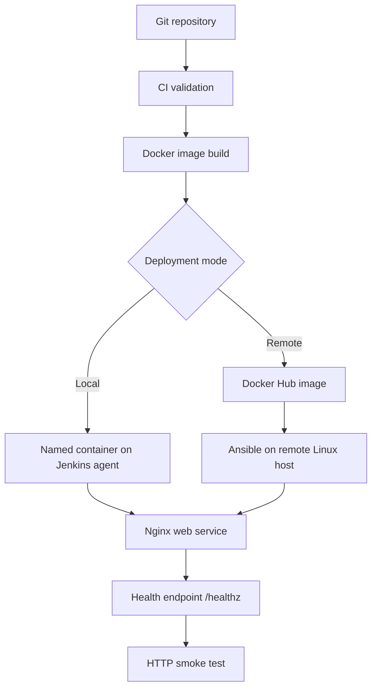

Jenkins is the deployment pipeline. GitHub Actions and Azure Pipelines independently validate source files, build the image, run a temporary container, and execute the smoke test.

## Repository structure

```text
.
├── .github/workflows/ci.yml     # GitHub Actions build and smoke test
├── app/
│   ├── index.html               # Application markup
│   └── assets/
│       ├── main.js              # Accessible navigation and copy action
│       └── styles.css           # Responsive visual system
├── ansible/
│   ├── deploy.yml               # Remote container deployment and health check
│   └── requirements.yml         # Required Ansible collection
├── docker/
│   └── nginx.conf               # Routing, health endpoint, security headers
├── docs/
│   ├── architecture.md
│   ├── operations.md
│   └── evidence/
│       ├── README.md            # Full screenshot guide and troubleshooting
│       └── screenshots/         # 25 supplied, curated evidence images
├── tests/
│   ├── smoke_test.py            # Standard-library HTTP verification
│   └── browser_smoke.py         # Optional Selenium check
├── Dockerfile
├── docker-compose.yml
├── Jenkinsfile
├── azure-pipelines.yml
├── SECURITY.md
├── CONTRIBUTING.md
└── README.md
```

## Requirements

### Local run

- Git
- Docker Engine or Docker Desktop with the Docker Compose plugin
- Python 3.10 or newer for the HTTP smoke test

### Jenkins deployment

Use a dedicated, trusted Linux build agent with:

- Git
- Docker CLI and daemon access
- Python 3
- curl
- Ansible and SSH Agent plugin for remote deployment

Docker daemon access is privileged. Do not grant it to untrusted jobs or make the Docker socket world-writable.

### Remote Ansible deployment

- A reachable Debian/Ubuntu Linux host with SSH access
- A user with approved privilege escalation to install/run Docker
- A trusted SSH host key recorded on the Jenkins agent
- An image available from a registry if deploying remotely
- Jenkins credentials configured as described below

## Run locally

Build and start the application:

```bash
docker compose up --build -d
docker compose ps
```

Open [http://localhost:8082](http://localhost:8082).

Run the HTTP smoke test:

```bash
python3 tests/smoke_test.py http://127.0.0.1:8082/
```

Check the health endpoint and logs:

```bash
curl --fail --show-error http://127.0.0.1:8082/healthz
docker inspect --format '{{.State.Health.Status}}' releaseforge-website
docker compose logs --tail=100 website
```

Stop the application:

```bash
docker compose down
```

### Change the local port

If port `8082` is already occupied, use a different host port.

Linux/macOS:

```bash
WEB_PORT=8090 docker compose up --build -d
python3 tests/smoke_test.py http://127.0.0.1:8090/
```

PowerShell:

```powershell
$env:WEB_PORT = "8090"
docker compose up --build -d
python tests/smoke_test.py http://127.0.0.1:8090/
```

## CI/CD workflows

### GitHub Actions

The workflow in `.github/workflows/ci.yml` runs on pushes and pull requests. It checks required files, validates the smoke-test script, builds the Docker image, starts a temporary container, waits for `/healthz`, verifies the page, and removes the temporary container.

### Azure Pipelines

`azure-pipelines.yml` performs equivalent source validation, image build, and container smoke testing on an Ubuntu hosted agent. It is optional and does not replace Jenkins deployment.

### Jenkins

The root `Jenkinsfile` supports two deployment modes.

| Parameter | Default | Purpose |
|---|---|---|
| `DEPLOY_MODE` | `local` | Deploy to the Jenkins agent or a remote host |
| `SERVER_IP` | empty | Remote host address; required for remote mode |
| `ANSIBLE_USER` | `ubuntu` | SSH user for remote deployment |
| `PUSH_IMAGE` | `false` | Publish the built image to Docker Hub |
| `DOCKERHUB_NAMESPACE` | empty | Docker Hub namespace used for publishing or remote deployment |

The Jenkins agent must have the tools listed above. Configure a Pipeline job using **Pipeline script from SCM** and the repository's root `Jenkinsfile`.

#### Jenkins credentials

Create these credentials only if using the relevant feature:

- `dockerhub-credentials`: Jenkins **Username with password** credential, using a Docker Hub access token as the password.
- `deployment-ssh-key`: Jenkins **SSH Username with private key** credential for the remote target.

For local deployment, leave `PUSH_IMAGE` disabled. For remote deployment, provide `SERVER_IP`, `ANSIBLE_USER`, and `DOCKERHUB_NAMESPACE`, configure both credentials, install the SSH Agent plugin, and confirm host-key verification works before running the job. Do not paste secrets into job parameters or repository files.

> **Operational note:** the local Jenkins deployment persists the named `releaseforge-website` container on port `8082`. It replaces only that named project container; it does not stop or delete unrelated containers. Remote deployment uses Ansible to recreate the named service on the target host.

## Validation and tests

The HTTP smoke test uses only Python's standard library:

```bash
python3 tests/smoke_test.py http://127.0.0.1:8082/
```

Expected output includes a successful homepage response and a successful `/healthz` response.

Optional browser-level verification:

```bash
python3 -m pip install -r requirements-test.txt
python3 tests/browser_smoke.py http://127.0.0.1:8082/
```

The Selenium test requires Chrome/Chromium and Selenium Manager-compatible network access. If browser setup is unavailable, the HTTP smoke test still validates service reachability and expected page markers.

## Troubleshooting

| Symptom | Likely cause | Recommended action |
|---|---|---|
| Port `8082` is already allocated | Another service is listening on the host port | Use `WEB_PORT=8090` or identify the process owning the port; do not terminate unrelated services blindly |
| Container is unhealthy | Nginx did not start or `/healthz` is not responding | Run `docker compose logs --tail=100 website`, inspect container health, and request `/healthz` from the host |
| Docker permission denied | Agent account lacks approved daemon access | Check Docker service status and service-account permissions with the system administrator; never use `chmod 666 /var/run/docker.sock` |
| Jenkins agent is offline | Network, Java, permissions, or remote-root issue | Read the node launch log, verify controller reachability, check Java, and ensure the configured remote root is writable |
| Jenkins workspace `AccessDeniedException` | Remote root or workspace ownership is wrong | Use a dedicated writable workspace and correct ownership for the Jenkins service account |
| Jenkins checkout fails | Repository URL, branch, credentials, or Git setup is wrong | Verify the SCM URL and branch, check credentials, and confirm Git is installed on the actual agent |
| Remote deployment fails | SSH access, host key, privilege escalation, or target connectivity is incorrect | Verify SSH reachability and known-hosts configuration; keep host-key checking enabled |
| Docker Hub push fails | Wrong namespace or registry credential | Confirm the namespace and use a Docker Hub access token in Jenkins Credentials |
| Remote image pull fails | Image name/tag is wrong or the registry requires authentication | Confirm the published tag and configure registry authentication on the target host |
| HTTP test returns non-200 | Container not ready, wrong port, or wrong URL | Check container state and port mapping; wait for `/healthz` before running the full smoke test |
| Public website cannot be reached | Firewall target tag, port rule, or VM lifecycle mismatch | Confirm the service is running, the firewall rule targets the VM, and the VM still exists; expose only required ports |
| Selenium cannot start Chrome | Browser/driver dependency or environment issue | Install a supported browser, check Selenium Manager network access, or run the standard-library HTTP smoke test |

For command-level guidance, see [`docs/operations.md`](docs/operations.md). For the deployment design, see [`docs/architecture.md`](docs/architecture.md).

## Deployment evidence

The screenshots below document the earlier Google Cloud VM, Jenkins setup, agent configuration, build execution, container status, and site verification. Every entry has a heading, context, expected result, and troubleshooting notes. Expand a step to view its screenshot.

> **Security note:** the agent debugging screenshot has been redacted because the original terminal included a Jenkins agent secret. Review the original images separately before republishing them. If a secret may still be active, invalidate it and remove any stale node configuration.

<details>
<summary><strong>Step 01 — Create the Google Cloud VM</strong></summary>

This screen records the initial VM configuration used to host the Jenkins controller or build environment.

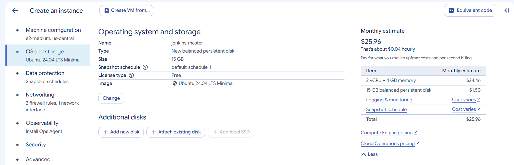

**Expected outcome:** Confirm the chosen region, machine type, boot disk, and network before creating the instance.

**If something goes wrong:** If creation fails, check quota, selected zone capacity, IAM permissions, and whether the selected machine type is available.

</details>

<details>
<summary><strong>Step 02 — Review VM operating-system and storage settings</strong></summary>

This step shows the selected operating system, disk, and instance configuration.

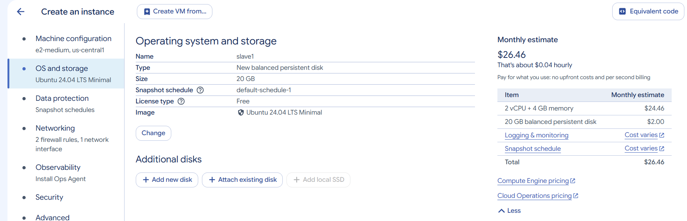

**Expected outcome:** Use a supported OS image, a disk size appropriate for the workload, and a documented instance name.

**If something goes wrong:** If SSH or package installation fails, confirm the VM is running, the boot disk has enough space, and the OS image matches the instructions.

</details>

<details>
<summary><strong>Step 03 — Configure the required network rule</strong></summary>

This screenshot documents the firewall rule used to reach the service or Jenkins endpoint.

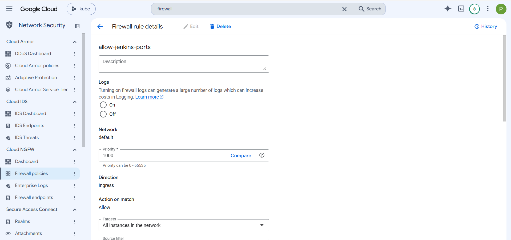

**Expected outcome:** Allow only required TCP ports and target only the intended VM using a network tag or service account.

**If something goes wrong:** If the page is unreachable, verify the VM has the matching network tag, the rule applies to the correct VPC, and the application is listening on that port. Avoid opening admin ports to the entire internet.

</details>

<details>
<summary><strong>Step 04 — Install Jenkins and its prerequisites</strong></summary>

Terminal output documents the Jenkins installation and package setup.

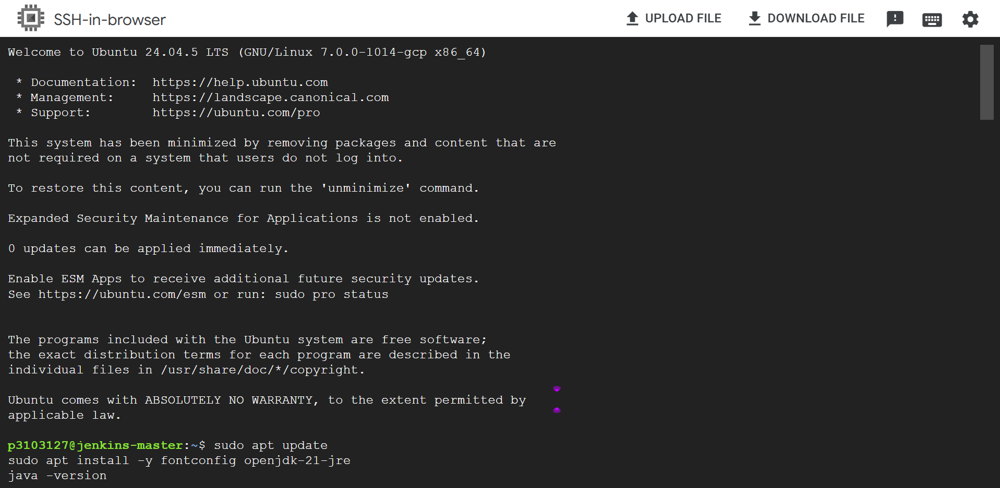

**Expected outcome:** Package installation completes without unresolved dependency or repository errors.

**If something goes wrong:** If installation fails, check apt repository configuration, package indexes, disk space, and network connectivity; inspect the first error rather than retrying blindly.

</details>

<details>
<summary><strong>Step 05 — Install Java and supporting packages</strong></summary>

This step records installation of packages required by Jenkins and its runtime.

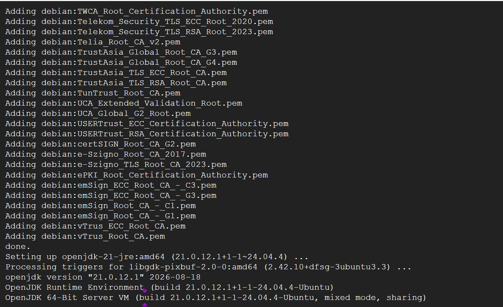

**Expected outcome:** The package manager finishes successfully and the required Java runtime is available.

**If something goes wrong:** If packages cannot be resolved, refresh package indexes, confirm repository availability, and check the supported Java version for the installed Jenkins release.

</details>

<details>
<summary><strong>Step 06 — Download the Jenkins inbound agent</strong></summary>

This terminal output shows the agent JAR being downloaded from the Jenkins controller.

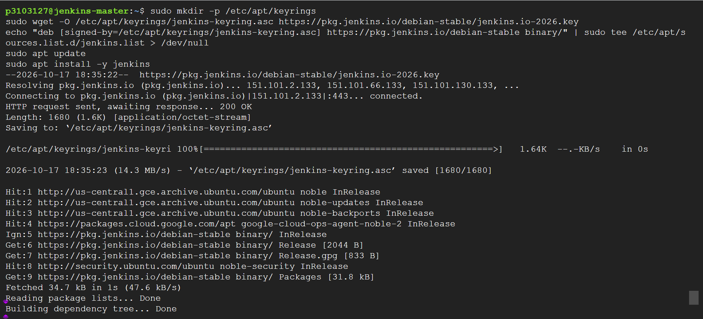

**Expected outcome:** The download completes and the file exists on the intended agent machine.

**If something goes wrong:** If the download returns an error, verify controller URL, DNS/network access, controller port, and the agent JAR path. Do not publish a raw agent launch command or secret.

</details>

<details>
<summary><strong>Step 07 — Verify Jenkins service state</strong></summary>

This screenshot records service setup and/or runtime status on the host.

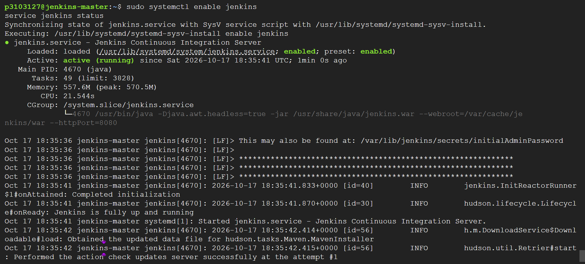

**Expected outcome:** The service is active and enabled, and the logs do not show a repeating startup failure.

**If something goes wrong:** Use `sudo systemctl status jenkins --no-pager` and `sudo journalctl -u jenkins -n 100 --no-pager`. Check Java version, memory pressure, and port conflicts.

</details>

<details>
<summary><strong>Step 08 — Review the Compute Engine instance</strong></summary>

The cloud console overview shows the VM resource and its operational state.

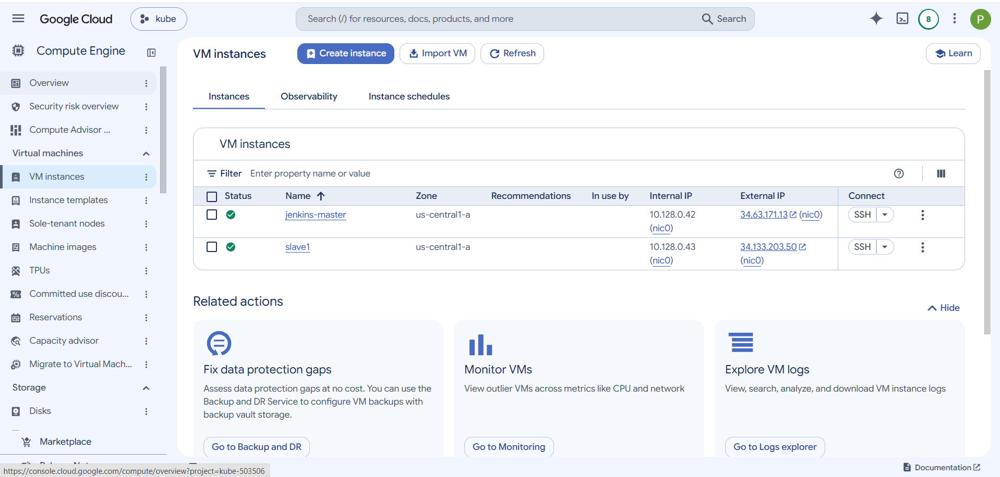

**Expected outcome:** The expected instance is running and its name, zone, and network are correct.

**If something goes wrong:** If the instance is stopped or missing, inspect its lifecycle state, operation errors, quotas, and audit logs before recreating it.

</details>

<details>
<summary><strong>Step 09 — Unlock Jenkins securely</strong></summary>

The initial Jenkins setup page prompts for the one-time administrator unlock secret.

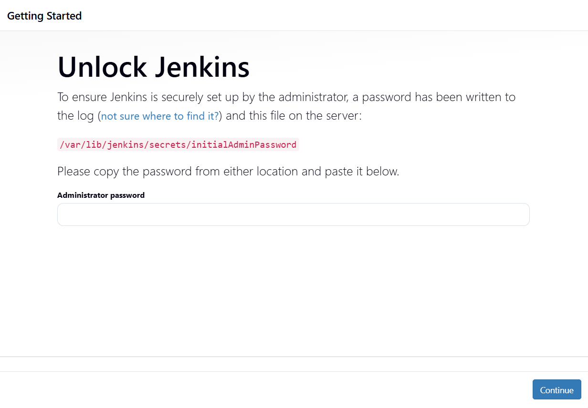

**Expected outcome:** Retrieve the initial password from the host's protected Jenkins setup file and enter it directly in the trusted browser session.

**If something goes wrong:** If the password is unavailable, read it over SSH with appropriate permissions. Never commit it to source control or share a screenshot containing it.

</details>

<details>
<summary><strong>Step 10 — Choose the initial Jenkins plugins</strong></summary>

This screen records the plugin selection during first-run setup.

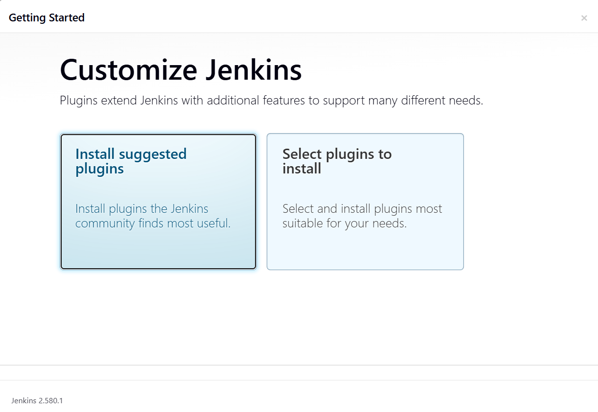

**Expected outcome:** Install only the plugins needed for the intended pipeline; avoid adding plugins without a clear use case.

**If something goes wrong:** If installation hangs, check controller internet access, plugin-center connectivity, proxy settings, and Jenkins logs. Restart only after reviewing the cause.

</details>

<details>
<summary><strong>Step 11 — Wait for plugin installation to finish</strong></summary>

The setup screen shows progress while Jenkins installs selected plugins.

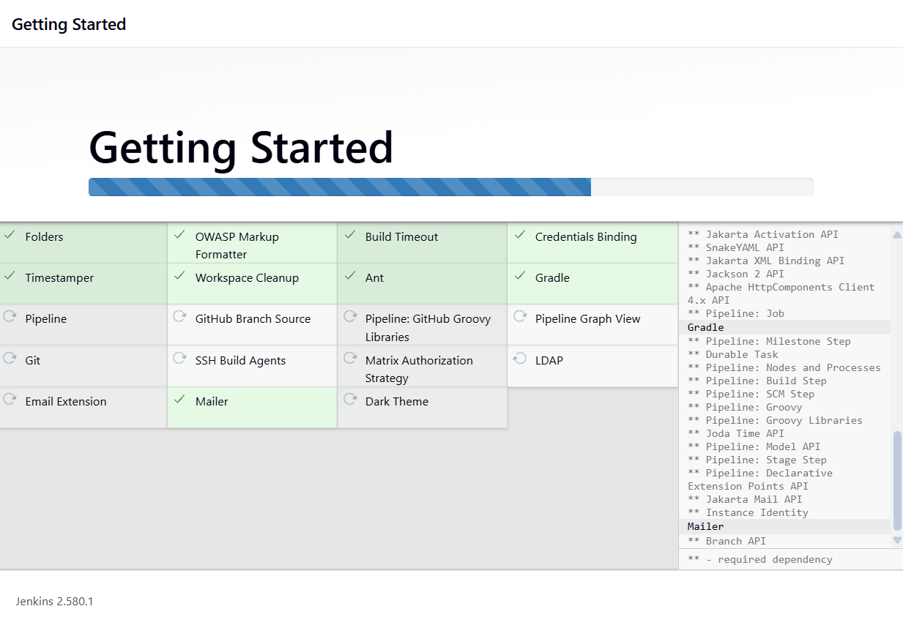

**Expected outcome:** Required plugins complete installation and Jenkins proceeds to the next setup step.

**If something goes wrong:** If a plugin fails, inspect the failure details, update the plugin center metadata, and check version compatibility before retrying.

</details>

<details>
<summary><strong>Step 12 — Create the Jenkins administrator account</strong></summary>

This screen documents the initial admin user setup.

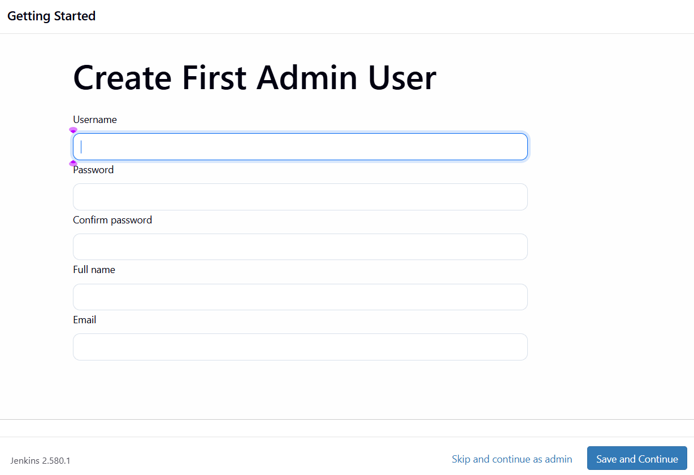

**Expected outcome:** Use a unique admin username and strong password; store the credentials in an approved password manager.

**If something goes wrong:** If setup cannot continue, verify all required fields and confirm the controller can write to its Jenkins home directory. Never include the password in screenshots.

</details>

<details>
<summary><strong>Step 13 — Confirm the Jenkins dashboard is available</strong></summary>

The dashboard confirms the controller is ready for job and node configuration.

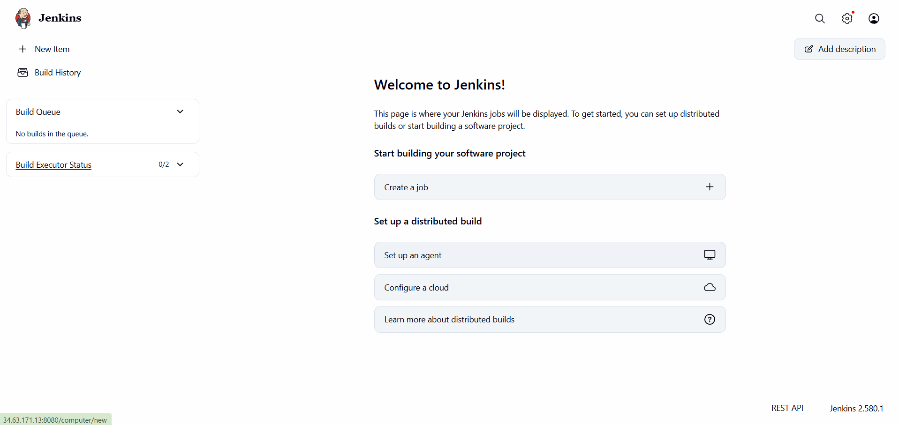

**Expected outcome:** The UI loads and the administrator can navigate to Nodes and Jobs.

**If something goes wrong:** If the dashboard is blank or unavailable, check service status, controller logs, browser console, reverse-proxy settings, and port 8080 reachability.

</details>

<details>
<summary><strong>Step 14 — Prepare the build agent</strong></summary>

This terminal output documents agent-side setup and/or installation of build dependencies.

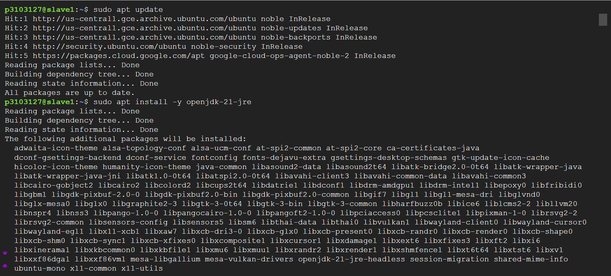

**Expected outcome:** The agent has the tools required by the job: Git, Python 3, Docker CLI/daemon access, and curl.

**If something goes wrong:** If commands are missing, install the required packages and confirm the Jenkins service account has approved Docker access. Never make the Docker socket world-writable.

</details>

<details>
<summary><strong>Step 15 — Configure the Jenkins agent connection</strong></summary>

This screen records the node's connection method and remote working directory.

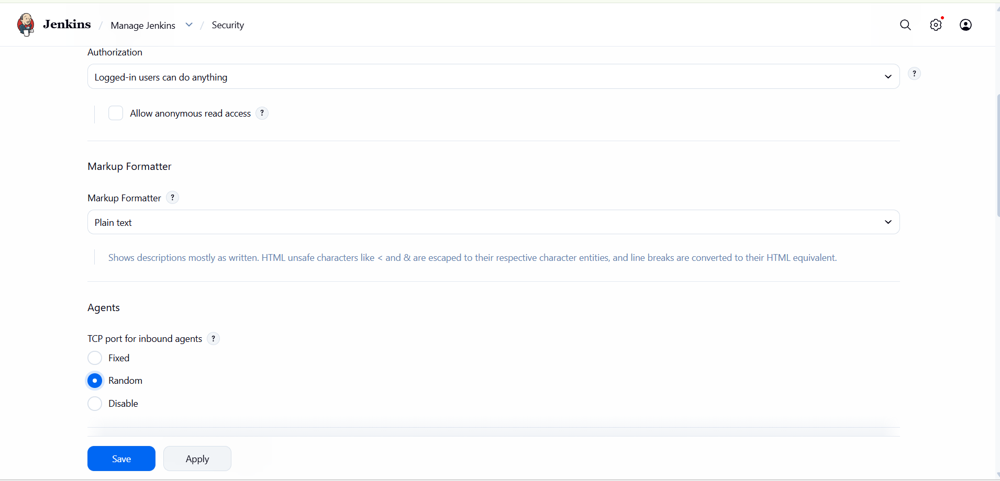

**Expected outcome:** The node name, labels, launch method, and remote root match the host configuration.

**If something goes wrong:** If the node stays offline, verify the agent can reach the controller, the remote directory is writable, Java is installed, and the launch log has no authentication or WebSocket errors.

</details>

<details>
<summary><strong>Step 16 — Register the build node</strong></summary>

The node creation screen defines the agent used for build execution.

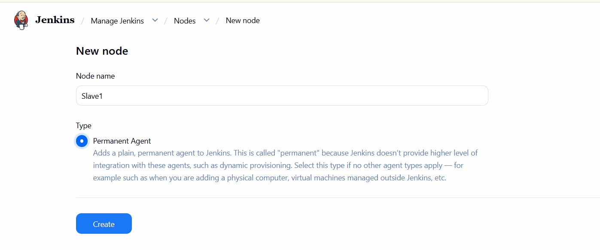

**Expected outcome:** The node is created with an appropriate executor count, labels, and remote root directory.

**If something goes wrong:** If node creation or connection fails, check the remote root ownership and ensure the directory exists. Keep executors conservative on low-memory machines.

</details>

<details>
<summary><strong>Step 17 — Set job execution options</strong></summary>

This screen documents the selected Jenkins job settings or build parameters.

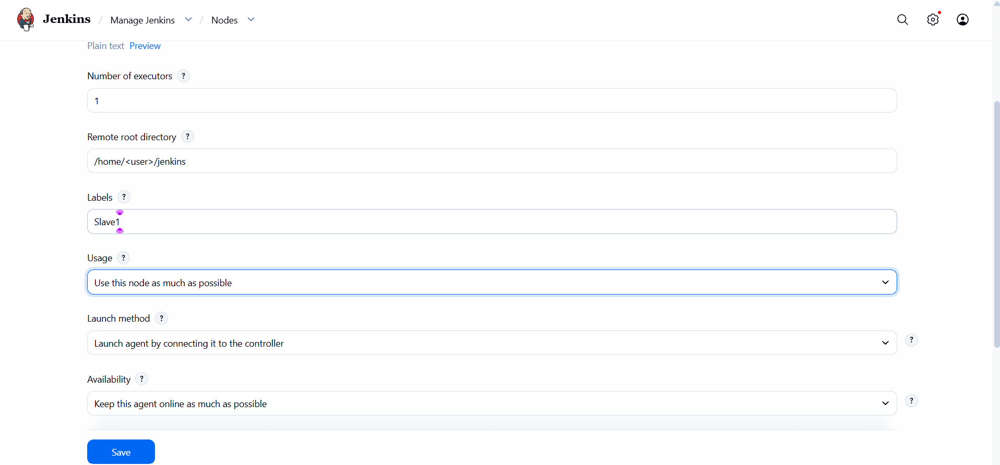

**Expected outcome:** The job uses the correct SCM source and deployment mode; credentials are referenced by ID rather than embedded in scripts.

**If something goes wrong:** If a parameter is missing, save the job configuration and reload the job. Keep remote deployment disabled until credentials and target access are verified.

</details>

<details>
<summary><strong>Step 18 — Troubleshoot agent connection and workspace permissions</strong></summary>

The original terminal showed an agent launch attempt and a workspace permission error. The credential-bearing command has been redacted.

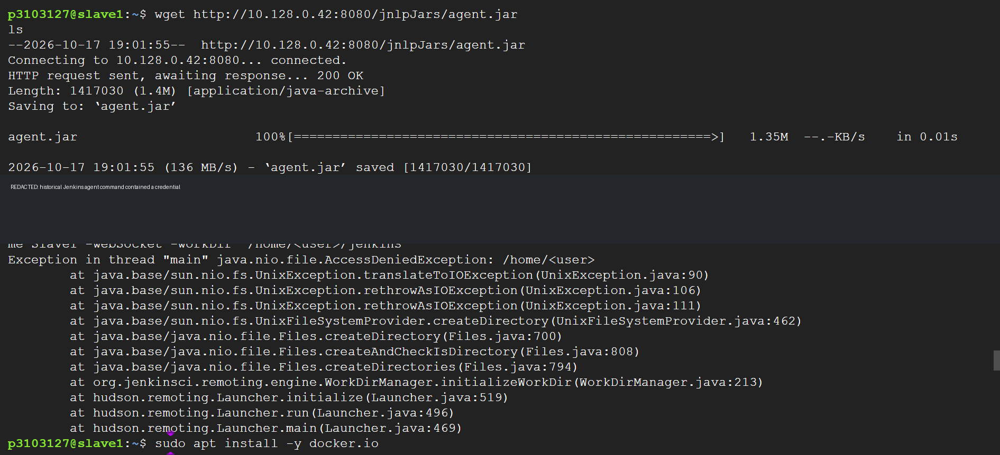

**Expected outcome:** The agent should launch without exposing its secret, and the remote working directory should be writable by the Jenkins service account.

**If something goes wrong:** For `AccessDeniedException`, set the remote root to a dedicated writable directory and correct ownership. If a secret was ever exposed publicly, invalidate/rotate it and remove the stale agent.

</details>

<details>
<summary><strong>Step 19 — Configure the CI/CD job</strong></summary>

This screen shows the job setup used to run the project's build and deployment workflow.

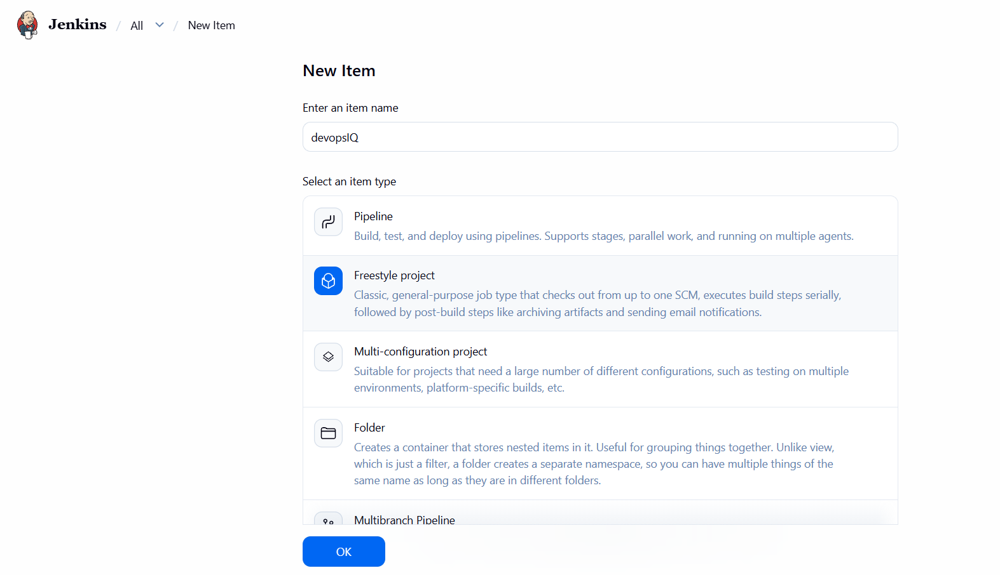

**Expected outcome:** The job points to the intended repository and branch, and its script source is version-controlled.

**If something goes wrong:** If checkout fails, verify the repository URL, branch name, SCM credentials, Git installation, and agent network access.

</details>

<details>
<summary><strong>Step 20 — Review the saved job configuration</strong></summary>

This screenshot records the job's general or pipeline configuration after setup.

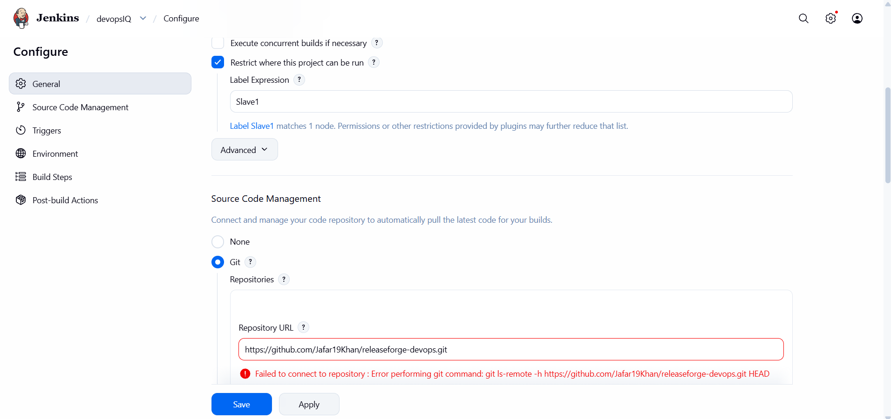

**Expected outcome:** The job configuration is saved and references the correct source and pipeline options.

**If something goes wrong:** If a build uses stale settings, save the job again, confirm the selected branch and Jenkinsfile path, then trigger a fresh build.

</details>

<details>
<summary><strong>Step 21 — Review build history and result</strong></summary>

The build history shows the job's recorded executions and statuses.

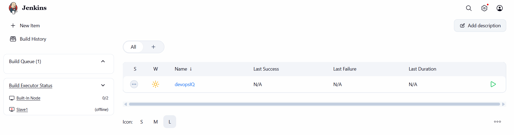

**Expected outcome:** A successful run is marked green/Success and its console output matches the expected commit and build number.

**If something goes wrong:** If a build is red, open Console Output and locate the first failing stage. Fix the root cause and rerun; do not hide a failed check.

</details>

<details>
<summary><strong>Step 22 — Inspect build and deployment commands</strong></summary>

The console output records source checkout, Docker build/deploy operations, and verification commands.

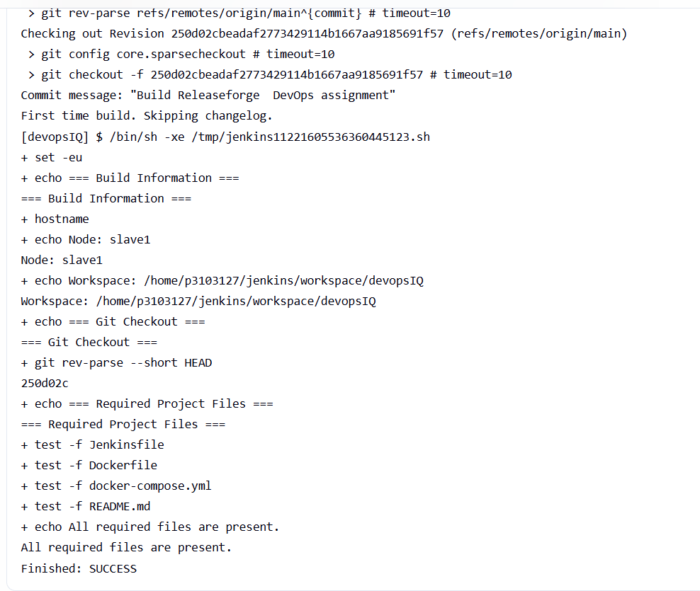

**Expected outcome:** The log shows the expected repository revision, image build, container start, and HTTP response check.

**If something goes wrong:** If Docker reports permission denied, inspect daemon availability and service-account group/permissions. If a port is occupied, select a free port instead of killing unrelated services.

</details>

<details>
<summary><strong>Step 23 — Confirm the job summary</strong></summary>

This screen records the configured job and its visible build status.

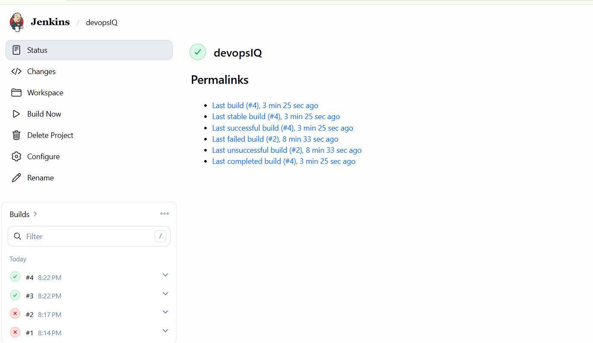

**Expected outcome:** The job exists and the most recent successful build is easy to identify.

**If something goes wrong:** If no successful build is present, open the latest console log and confirm the agent is online, the correct branch was built, and the smoke test ran.

</details>

<details>
<summary><strong>Step 24 — Verify the deployed ReleaseForge website</strong></summary>

This browser screenshot records the website responding after the historical deployment.

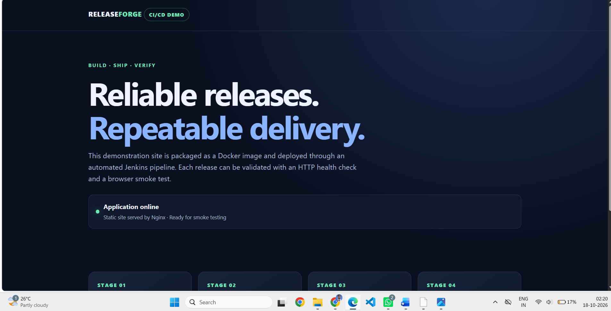

**Expected outcome:** The page renders its ReleaseForge title, primary message, and pipeline content without a browser network error.

**If something goes wrong:** If the browser cannot reach the site, check container health, host port mapping, firewall target tags, and whether the VM still exists. This screenshot is historical, not a current uptime claim.

</details>

<details>
<summary><strong>Step 25 — Verify the running container and port mapping</strong></summary>

This terminal output documents the named container, published port, and/or health status after deployment.

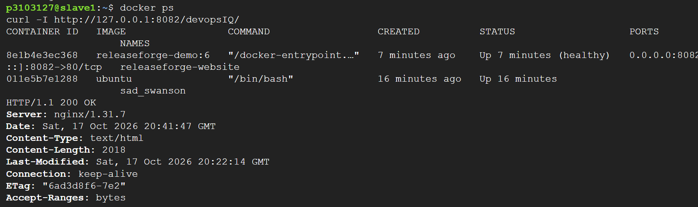

**Expected outcome:** The expected container is running, health reports `healthy`, and the published port points to container port 80.

**If something goes wrong:** If health is `starting` or `unhealthy`, run `docker logs releaseforge-website`, `docker inspect releaseforge-website`, and `curl -i http://127.0.0.1:8082/healthz`. Confirm the image contains the expected health route.

</details>


## Security and maintenance

- Never commit `.env` files, passwords, private keys, access tokens, cloud credentials, or Jenkins agent secrets.
- Use Jenkins Credentials for sensitive values and scope each credential to the jobs that require it.
- Keep SSH host-key checking enabled; do not use insecure shortcuts to make deployment pass.
- Limit firewall rules to the required ports and intended targets.
- Keep base images, dependencies, Jenkins plugins, and Ansible collections reviewed and updated.
- Check screenshots and logs for secrets and personal or infrastructure details before publication.
- Review `SECURITY.md` before exposing this service publicly.

## License

This repository is provided under the MIT License. See [`LICENSE`](LICENSE).
